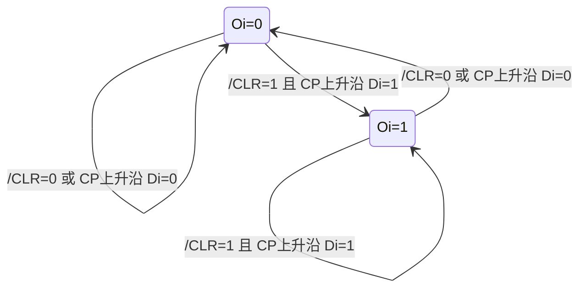

<!-- blog2-digital-logic-note -->

[← 返回本章芯片索引](/blog_test2/blog/%E5%AD%A6%E4%B9%A0%E7%AC%94%E8%AE%B0/%E6%95%B0%E7%94%B5/21-ch06-00_%E6%9C%AC%E7%AB%A0%E8%8A%AF%E7%89%87%E7%B4%A2%E5%BC%95/) · [方程与图表读法](/blog_test2/blog/%E5%AD%A6%E4%B9%A0%E7%AC%94%E8%AE%B0/%E6%95%B0%E7%94%B5/02-02_%E6%96%B9%E7%A8%8B%E4%B8%8E%E5%9B%BE%E8%A1%A8%E8%AF%BB%E6%B3%95/)

> [!abstract] 一句话记住
> **8位一起在 CP 上升沿存入数据；低有效 $\overline{CLR}$ 异步清零。**

## 1. 概念与功能

273包含8位上升沿D触发器，适合在一个时刻保存8位数据并让后级继续读取。定位仍为**教材综合应用对应**：现有题源没有独立指定273的考试题，不能把出现寄存模块等同指定这个型号。

## 2. 符号图与端口

*图6.4.2：引脚图，印刷172 / 原PDF189*

*表6.4.2：功能表，印刷172 / 原PDF189*

端口：D0…D7为8位输入；O0…O7为8位输出；CP上升沿；/CLR低有效异步清零；VCC/GND供电。教材给的是引脚图，不额外编造内部结构或OE。

## 3. 真值表与功能表

| $\overline{CLR}$ | CP | 8位输出 |
|:---:|:---:|:---|
| 0 | 任意 | 立即全 0 |
| 1 | ↑ | $O_i^{n+1}=D_i$，$i=0\ldots7$ |
| 1 | 无上升沿 | 保持原数据 |

优先级：异步清零 > 上升沿采样 > 保持。引脚图无三态输出使能端，不能当 74LS373 的替代品。

数字频率计中：计数结束后先给存储时钟，把读数保存在输出；然后清零计数器，显示端继续显示上次结果。

## 4. 驱动、输出与状态方程

**驱动条件**：8个边沿D触发器共享CP与/CLR；$D_i$由外部8位数据给定，不追加虚构的输出使能端。

**输出关系**：$O_i=Q_i$；$O=\sum_{i=0}^{7}2^iO_i$。无三态OE，数据在保持期间仍驱动输出。

**状态方程**：

$$
O^+=\begin{cases}0,&\overline{CLR}=0\\D,&\overline{CLR}=1\land CP\uparrow\\O,&\text{其他}\end{cases}
$$

这是8位并行行为式，优先级为异步清零>采样>保持；不是锁存器在CP高电平持续透明。

## 5. 状态转移表

| 现态O | 控制/事件 | 次态O+ |
|:---|:---|:---|
| 任意0…255 | /CLR=0 | 0 |
| 任意0…255 | /CLR=1且CP↑ | D（任意0…255） |
| 任意0…255 | /CLR=1且无CP↑ | O |

这是全部256态的压缩完备规则，不是只列3个存储状态。

## 6. 状态转移图

这是**任一位i的二状态投影**，非整个8位寄存器的两状态机。八位并行共有256个可能状态；无上升沿且不清零时各位保持。

## 7. 波形与时序

**自编时序示例，非原教材图。** 初态O=00；/CLR在t=4有效、4.5撤除，下一CP上升沿t=5；留恢复/移除间隔。横轴为相对时间，每小区间=0.5单位；只画稳定逻辑值，理想传播延迟为0，不代表器件实际纳秒参数。

复位脉宽及撤除至采样沿的间隔，假设均已满足器件要求；图中相对单位不换算成未核实的纳秒值。主要事件：

| 相对时间t | CP | /CLR | D(hex) | O(hex) |
|:---|:---|:---|:---|:---|
| 0 | 0 | 1 | 12 | 00 |
| 1 | 1 | 1 | 12 | 12 |
| 3 | 1 | 1 | 34 | 34 |
| 4 | 0 | 0 | 56 | 00 |
| 4.5 | 0 | 1 | 56 | 00 |
| 5 | 1 | 1 | 56 | 56 |
| 7 | 1 | 1 | 78 | 78 |
| 8 | 0 | 1 | 9A | 78 |

## 8. 级联与例子

**位宽扩展例（自编）**：两片273共享CP与/CLR；低片D0…D7接总线位0…7，高片接位8…15；输出按高片O[7:0]、低片O[7:0]拼成16位。

初态全0，数据总线0xA55A在CP↑前满足稳定条件，则沿后高片0xA5、低片0x5A，组合输出0xA55A。若/CLR=0，两片立即0，不等CP。两片同时取一帧数据是**位宽扩展**；若第一片O接第二片D则是两级流水寄存，第二片读第一片旧数据，需要另一个有效沿才传到。

## 9. 常考题型与例题分析

**真实题源关联：2015真题十。** 图(a)F为寄存模块，但实际设问仅B整形、C定时、E计数，不能虚报它考了273或锁存清零次序。2024真题六21的泛型D波形可检验同样的有效沿采样原则，仍不代表273指定型号。

**教材应用分析**：11.6数字频率计先存计数结果、再清零计数器；寄存输出继续送译码显示。寄存CP和计数器清零的先后必须由控制波形保证；图中90清零疑点不可照抄。

**自编核验例（非真题）**：上述0xA55A位扩展与t=4异步清零分别检验并行取数和控制优先级。

1. **题源背景关联：框图F为寄存模块；实际设问只问B/C/E，不据此增加273考查断言** — 2015真题十·框图F<small>（本地资料未发布）</small>。
2. **同类D原理：按有效沿和初态画输出波形；该题用泛型D，未指定273** — 2024真题六21<small>（本地资料未发布）</small>。

> [!tip] 易混点
> 这是教材11.6数字频率计中的具体实现对应。题源链接是背景关联和同类D原理题，均不是273指定型号题；锁存再清零的顺序来自教材应用说明。273为上升沿触发，373为电平锁存，采样时机不同。

## 10. 易错点与教材依据

273为边沿寄存，373为电平锁存，采样方式不同。显示稳定不意味着计数器停止；寄存端和计数清零端分工不同。本卡不提供未给型号时序规格的纳秒数。

§6.4文字：印刷170 / 原PDF187；图6.4.2、表6.4.2：印刷172 / 原PDF189；§11.6图11.6.3综合应用：印刷375 / 原PDF392。
