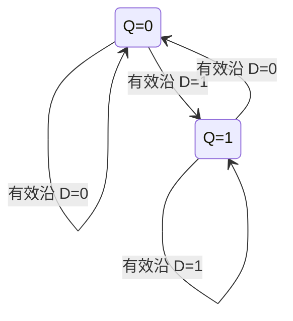

<!-- blog2-digital-logic-note -->

[← 返回本章芯片索引](/blog_test2/blog/%E5%AD%A6%E4%B9%A0%E7%AC%94%E8%AE%B0/%E6%95%B0%E7%94%B5/21-ch06-00_%E6%9C%AC%E7%AB%A0%E8%8A%AF%E7%89%87%E7%B4%A2%E5%BC%95/) · [方程与图表读法](/blog_test2/blog/%E5%AD%A6%E4%B9%A0%E7%AC%94%E8%AE%B0/%E6%95%B0%E7%94%B5/02-02_%E6%96%B9%E7%A8%8B%E4%B8%8E%E5%9B%BE%E8%A1%A8%E8%AF%BB%E6%B3%95/)

> [!abstract] 一句话记住
> **有效时钟沿采样：$Q^{n+1}=D$；先处理异步置 0/置 1，再看边沿。**

## 1. 概念与功能

D触发器存1位并在有效沿采样D，适于寄存器、延迟和同步状态机。泛型题没有固定型号，CP上/下沿与异步置位极性必须逐图识别。

## 2. 符号图与端口

*图6.3.5(a)：例题中的上升沿 D 符号，印刷164 / 原PDF181*

*表6.3.3：下降沿型功能表，不能套用到上图的上升沿时刻*

> [!note]- 教材原理图
> 
>
> *图6.3.4(a)：主从连接原理，印刷163 / 原PDF180*

端口：D为数据，CP为触发时钟；/Rd与/Sd分别低有效异步置0/置1；Q、Q反为互补输出。教材原表是下降沿型，上升沿示例图不能照搬其下降沿时刻。

## 3. 真值表与功能表

| 条件 | 结果 |
|:---|:---|
| $\bar R_d=0,\bar S_d=1$ | 立即置 0 |
| $\bar R_d=1,\bar S_d=0$ | 立即置 1 |
| 两异步端均为 1，有效沿到达 | 取沿前的 $D$ |
| 两异步端均为 1，没有有效沿 | 保持 |

次态直接给驱动：$D_i=Q_i^{n+1}$；接 $D=\bar Q$ 得 $Q^{n+1}=\bar Q^n$，构成二分频。

级联触发器在同一有效沿**同时读取旧值**；不能把前一级刚更新的值立即传给后一级。上升沿/下降沿由题图 CP 气泡或代码 `posedge/negedge` 决定。

## 4. 驱动、输出与状态方程

**驱动条件**：$E=CP\uparrow$或$CP\downarrow$，由题图气泡决定；设计同步时序电路时 $D_i=Q_i^+$。

**输出方程**：Y=Q（若取反端则Y=¬Q），是状态的直接输出。

**状态方程**：异步置0有效→Q+=0；异步置1有效→Q+=1；两异步端无效且E发生→Q+=D；否则Q+=Q。二者同时有效不规定正常优先级。

共同CP级联：$Q_1^+=D$，$Q_2^+=Q_1$，右端均为沿前旧值；D锁存器则在有效电平期间透明，不适用这条“只在沿上取值”的规则。

## 5. 状态转移表

| Q | D | 有效沿后Q+ |
|:---|:---|:---|
| 0 | 0 | 0 |
| 0 | 1 | 1 |
| 1 | 0 | 0 |
| 1 | 1 | 1 |

无有效沿保持Q；异步控制另按优先关系处理。

## 6. 状态转移图

图限异步端无效、已约定有效沿；无有效沿时均保持。异步置0把任一状态拉到Q=0，异步置1拉到Q=1；两端同时有效不列为正常工作。

## 7. 波形与时序

**自编时序示例，非原教材图。** 初态Q=0；/Rd=/Sd=1；示例选CP上升沿；D在沿前已稳定。横轴为相对时间，每小区间=1单位；只画稳定逻辑值，理想传播延迟为0，不代表器件实际纳秒参数。

| 有效上升沿 | 沿前D | 沿后Q |
|:---|:---|:---|
| 1 | 1 | 1 |
| 2 | 0 | 0 |
| 3 | 1 | 1 |
| 4 | 1 | 1 |
| 5 | 0 | 0 |

## 8. 级联与例子

**串接移位/延迟例（自编）**：两只同沿D触发器共CP，第一只D接串行x，第一只Q接第二只D；两个异步端均无效，初态Q1Q2=00。

输入沿前x依次1、0、1、1时：

| CP↑次数 | 沿前x | 沿后Q1Q2 |
|:---|:---|:---|
| 1 | 1 | 10 |
| 2 | 0 | 01 |
| 3 | 1 | 10 |
| 4 | 1 | 11 |

第二级在第2个有效沿才出现第1拍输入1；四拍序列用旧态同时更新验证。串接是时间/位移扩展，不能把Q输出直接并接。

## 9. 常考题型与例题分析

**真实例题关键结果：2013真题五5。** 接D=Q反后，每个有效沿翻转一次；输出周期需要两个CP周期，频率fQ=fCP/2。若初态Q=0，沿后依次1、0、1、0。2024真题六21是两级D波形题，按原图分别列D1/D2和异步端，再用沿前旧值同时更新。

**自编核验例（非真题）**：上节Q1Q2=10、01、10、11；把Q2第一拍写成1，说明错误地连算了同一时刻的两级。

1. **由零初态逐拍画两级 D 输出波形** — 2024真题六21<small>（本地资料未发布）</small>。
2. **D 接反输出，求二分频关系** — 2013真题五5<small>（本地资料未发布）</small>。
3. **用采样和少量门判别同步信号占空比** — 2011真题六2<small>（本地资料未发布）</small>。
4. **按下降沿 Verilog 和初态还原波形** — 2019真题六1<small>（本地资料未发布）</small>。

> [!tip] 易混点
> 透明的 D 锁存器与边沿 D 触发器采样时机不同。对 CP 气泡和异步端小圆圈分别判断，两个小圆圈不表示同一种功能。

## 10. 易错点与教材依据

有效沿不是任何跳变；时钟端气泡与异步端气泡的作用不同。建立/保持时间要求D在采样沿附近稳定，本示例未提供具体型号，不编造纳秒参数。

§6.3.2；主从图6.3.4：印刷163 / 原PDF180；边沿表6.3.3、上升沿示例图6.3.5：印刷164 / 原PDF181。
