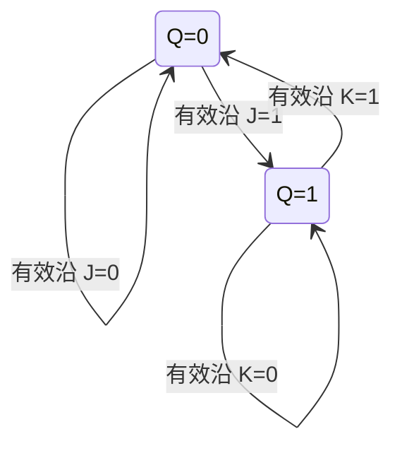

<!-- blog2-digital-logic-note -->

[← 返回本章芯片索引](/blog_test2/blog/%E5%AD%A6%E4%B9%A0%E7%AC%94%E8%AE%B0/%E6%95%B0%E7%94%B5/21-ch06-00_%E6%9C%AC%E7%AB%A0%E8%8A%AF%E7%89%87%E7%B4%A2%E5%BC%95/) · [方程与图表读法](/blog_test2/blog/%E5%AD%A6%E4%B9%A0%E7%AC%94%E8%AE%B0/%E6%95%B0%E7%94%B5/02-02_%E6%96%B9%E7%A8%8B%E4%B8%8E%E5%9B%BE%E8%A1%A8%E8%AF%BB%E6%B3%95/)

> [!abstract] 一句话记住
> **有效沿时，JK=00 保持、01 置0、10 置1、11 翻转。**

## 1. 概念与功能

JK有保持、置0、置1、翻转四种同步功能，适合计数器和从状态图反推驱动。泛型卡不补造74LS具体型号；上/下沿均有教材符号。

## 2. 符号图与端口

*图6.3.7：(a)下降沿、(b)上升沿，印刷165 / 原PDF182*

*表6.3.4：下降沿型功能表，印刷165 / 原PDF182*

J/K为数据驱动，CP为边沿时钟，/Rd、/Sd是异步置0/置1；Q及Q反为互补输出。教材图6.3.7(a)下降沿、(b)上升沿。

## 3. 真值表与功能表

$$
Q^{n+1}=J\bar Q^n+\bar KQ^n
$$

| $Q^n\to Q^{n+1}$ | J | K |
|:---:|:---:|:---:|
| $0\to0$ | 0 | × |
| $0\to1$ | 1 | × |
| $1\to0$ | × | 1 |
| $1\to1$ | × | 0 |

驱动表中的 × 可化简；状态分析中题目确定的输入值不能擅自改成 ×。异步端低有效：清零/置一优先于时钟；两端都无效时才代特性方程。

转换：$J=K=T$ 得 T 触发器，$Q^{n+1}=T\oplus Q^n$；$J=K=1$ 得 T′ 二分频。

## 4. 驱动、输出与状态方程

**驱动条件**：用目标次态推J/K可选 $J=\bar Q Q^+$、$K=Q\overline{Q^+}$；这是一个可行实现，驱动表中的无关项还能进一步化简。

**输出方程**：Y=Q或Y=¬Q，由题目选端；**状态方程**（异步端无效、有有效沿）$Q^+=J\bar Q+\bar KQ$。无有效沿保持；异步置0/置1按功能表优先。

J=K=T时 $Q^+=Q\oplus T$；J=K=1得到T′每沿翻转，不是RS的禁态。

## 5. 状态转移表

| Q | J K=00 | 01 | 10 | 11 |
|:---|:---|:---|:---|:---|
| 0 | 0 | 0 | 1 | 1 |
| 1 | 1 | 0 | 1 | 0 |

| 目标Q→Q+ | J | K |
|:---|:---|:---|
| 0→0 | 0 | × |
| 0→1 | 1 | × |
| 1→0 | × | 1 |
| 1→1 | × | 0 |

## 6. 状态转移图

异步端无效；在Q=0时K任意，在Q=1时J任意。它们是驱动化简的无关项，不是禁态。

## 7. 波形与时序

**自编时序示例，非原教材图。** 初态Q=0；异步端无效；本例CP上升沿；J/K沿前稳定。横轴为相对时间，每小区间=1单位；只画稳定逻辑值，理想传播延迟为0，不代表器件实际纳秒参数。

| 上升沿 | JK | 沿后Q |
|:---|:---|:---|
| 1 | 00 | 0 |
| 2 | 01 | 0 |
| 3 | 10 | 1 |
| 4 | 11 | 0 |
| 5 | 11 | 1 |

## 8. 级联与例子

**共同CP计数扩展（自编）**：两只上升沿JK组成2位同步二进制计数。低位J0=K0=1；高位J1=K1=Q0；共同CP，初态Q1Q0=00，异步端无效。

四拍后00→01→10→11→00，模4；高位在低位**沿前为1**时翻转，fQ1=fCP/4、占空比50%。若改用低位Q作高位CP，系统变异步链，触发边沿须重判，不能原封不动搬共同CP方程。

## 9. 常考题型与例题分析

**真实题分析：2019真题七。** 原题给状态图，先给现态与输入逐行列次态，再对每一位用驱动表反推J/K、利用×化简，最后代回特性方程检查全部转换；输出方程从箭头/节点取值并判Mealy/Moore，不能由驱动表顺便猜。

**自编核验例（非真题）**：上节2位计数器完整4态和fCP/4是检验结果；同沿时高位用旧Q0，不用刚翻转的新Q0。

1. **先读门图求 J/K，再代特性方程求反输出次态** — 2007真题六1(2)<small>（本地资料未发布）</small>。
2. **从给定状态图列 JK 驱动和输出方程** — 2019真题七<small>（本地资料未发布）</small>。
3. **把 Verilog 状态机转换为 JK 驱动方程** — 2022真题八<small>（本地资料未发布）</small>。

> [!tip] 易混点
> “同步电路”指各触发器共享时钟；JK 的 J=K=1 是翻转，不是禁态。次态式中必须保留原状态 Q 的影响。

## 10. 易错点与教材依据

与RS不同，JK=11正常翻转。次态不是J的直接值；K须取反后参与保持项。驱动表×仅在该现态的该输入无关时成立。

§6.3.3；图6.3.7、表6.3.4、式(6.3.3)：印刷165 / 原PDF182；表6.3.5驱动表：印刷166 / 原PDF183。
