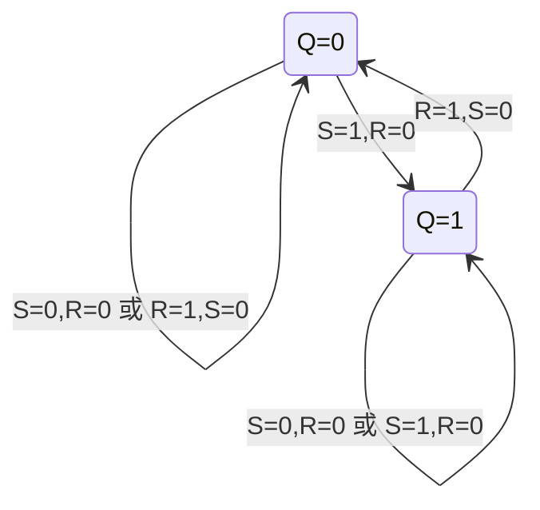

<!-- blog2-digital-logic-note -->

[← 返回本章芯片索引](/blog_test2/blog/%E5%AD%A6%E4%B9%A0%E7%AC%94%E8%AE%B0/%E6%95%B0%E7%94%B5/21-ch06-00_%E6%9C%AC%E7%AB%A0%E8%8A%AF%E7%89%87%E7%B4%A2%E5%BC%95/) · [方程与图表读法](/blog_test2/blog/%E5%AD%A6%E4%B9%A0%E7%AC%94%E8%AE%B0/%E6%95%B0%E7%94%B5/02-02_%E6%96%B9%E7%A8%8B%E4%B8%8E%E5%9B%BE%E8%A1%A8%E8%AF%BB%E6%B3%95/)

> [!abstract] 一句话记住
> **先分清门型与有效电平，再判断保持或置位；基本 RS 没有时钟端。**

## 1. 概念与功能

一个基本RS存储1位；交叉反馈形成两个稳定态。外部置位/复位直接改变状态，所以首先看门型及有效电平，而不是寻找时钟边沿。

## 2. 符号图与端口

*图6.2.1：与非门基本 RS，印刷159 / 原PDF176*

*表6.2.1：与非门功能表，印刷159 / 原PDF176*

*图6.2.5：或非门基本 RS，印刷160 / 原PDF177*

端口：与非型/Rd、/Sd低有效；或非型Rd、Sd高有效；Q为状态，Q反在合法稳定态互补。输入小圆圈表示低有效；基本RS没有CP端。

## 3. 真值表与功能表

| 构成 | 置 0 | 置 1 | 保持 | 禁用组合 |
|:---|:---:|:---:|:---:|:---|
| 与非门，输入 $\bar R_d\bar S_d$ | 01 | 10 | 11 | 00：强迫 $Q=\bar Q=1$ |
| 或非门，输入 $R_dS_d$ | 10 | 01 | 00 | 11：强迫 $Q=\bar Q=0$ |

禁用输入**同时撤销**后，最终稳定状态可能不确定；不能把禁用输入作用期间的两个输出也写成任意值。

或非型特性方程：$Q^{n+1}=S_d+\bar R_dQ^n$，约束 $R_dS_d=0$。与非型：$Q^{n+1}=\overline{\bar S_d}+\bar R_dQ^n$，约束 $\bar R_d+\bar S_d=1$。

## 4. 驱动、输出与状态方程

**驱动条件**：基本RS无CP。为统一记号，定义高有效R/S：或非型R=Rd、S=Sd；与非型R=¬/Rd、S=¬/Sd。

**输出关系**：合法稳定态 $\bar Q=\overline Q$。与非门禁态两输入均0时Q=Q反=1，或非门禁态两输入均1时两输出均0，此时不能用互补关系。

**状态方程**：$Q^+=S+\bar RQ$，约束RS=0；高有效驱动表：0→0需S=0/R任意，0→1需S=1/R=0，1→0需R=1/S=0，1→1需R=0/S任意。禁态输入撤销后的竞争不由此二值方程决定。

## 5. 状态转移表

| 归一R S | 现态Q=0时次态 | 现态Q=1时次态 |
|:---|:---|:---|
| 00 | 0 | 1 |
| 01 | 1 | 1 |
| 10 | 0 | 0 |
| 11 | 禁用，不用特性式 | 禁用，不用特性式 |

## 6. 状态转移图

图中R/S为**归一后的高有效控制**；与非型物理端先反相：R=¬/Rd，S=¬/Sd。不画禁态为正常第三个稳定状态。

## 7. 波形与时序

**自编时序示例，非原教材图。** 与非型；初态Q=0；/Rd、/Sd不同时为0；无CP，输出响应控制变化。横轴为相对时间，每小区间=1单位；只画稳定逻辑值，理想传播延迟为0，不代表器件实际纳秒参数。

| 区间 | /Rd /Sd | Q（区间稳定值） |
|:---|:---|:---|
| 0 | 11 | 0 |
| 1 | 10 | 1 |
| 2 | 11 | 1 |
| 3 | 11 | 1 |
| 4 | 01 | 0 |
| 5 | 11 | 0 |
| 6 | 10 | 1 |
| 7 | 11 | 1 |

## 8. 级联与例子

**串接复合功能例（自编）：与非型SPDT开关去抖。** 两个物理输入各有上拉，开关公共端接地，两固定触点分别接/Sd和/Rd。假设开关为先断后合，两个输入不会同时0。

从置0端转到置1端：01→11→10→11→10。由表得到Q=0→0→1→1→1，触点在11/10间反复抖动仍只产生一次0→1。这里两个与非门是交叉反馈，不是把输出直接并接；基本RS不带时钟，直接串接两片也不会自动得到“两个CP延迟”的移位寄存器。

## 9. 常考题型与例题分析

**真实例题关键结果：2007真题五2(4)。** 与非型/Rd=/Sd=0时两门输出都被强迫为1；不是Q随机为0或1。只有同时撤销禁态后的最终竞争结果才可能不确定。2013真题五6是或非型两输入为0，按给定初态保持。

**自编核验例（非真题）**：去抖输入与Q序列见上节，逐项套物理功能表即可验证一次切换只得到一次有效输出跳变。

1. **判断与非型两低输入的输出状态** — 2007真题五2(4)<small>（本地资料未发布）</small>。
2. **从初态判或非型两零输入后的保持结果** — 2013真题五6<small>（本地资料未发布）</small>。
3. **沿反馈连线判断闭环是否稳定** — 2019真题五4<small>（本地资料未发布）</small>。

> [!tip] 易混点
> 把 R/S 名称、气泡和门型一起读；异步控制不用等 CP。开关去抖题要说明两次触点切换中何时置位、何时保持。

## 10. 易错点与教材依据

不要把保持输入、禁用组合、禁态撤销后的不确定三个概念混为一谈。特性方程必须附约束；教材符号中的异步端不等CP。

§6.2；图6.2.1、表6.2.1：印刷159，原PDF176；图6.2.5：印刷160，原PDF177。
