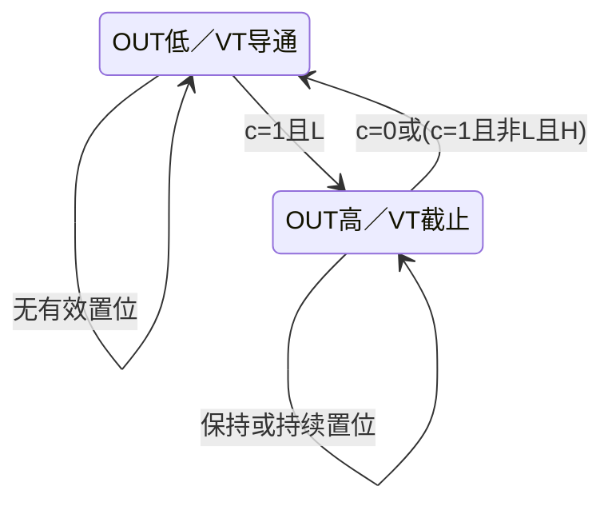

<!-- blog2-digital-logic-note -->

> [!abstract] 定位
> 题目指定器件。先按2、6、7、5脚接线识别拓扑，再选公式；下表以本教材CB555功能表为准。

[← 返回本章芯片索引](/blog_test2/blog/%E5%AD%A6%E4%B9%A0%E7%AC%94%E8%AE%B0/%E6%95%B0%E7%94%B5/50-ch09-00_%E6%9C%AC%E7%AB%A0%E8%8A%AF%E7%89%87%E7%B4%A2%E5%BC%95/) · [方程与图表读法](/blog_test2/blog/%E5%AD%A6%E4%B9%A0%E7%AC%94%E8%AE%B0/%E6%95%B0%E7%94%B5/02-02_%E6%96%B9%E7%A8%8B%E4%B8%8E%E5%9B%BE%E8%A1%A8%E8%AF%BB%E6%B3%95/)

## 1. 概念与功能

含比较器、参考分压、RS保持环节与放电管的混合电路。外部接法决定单稳／多谐／施密特／压控振荡；模拟定时电容是行为的一部分，不能仅用一个离散Q和固定时钟完整描述。

## 2. 符号图与端口

| 脚号 | 端名 | 作用 |
| --- | --- | --- |
| 1、8 | GND、$V_{\mathrm{CC}}$ | 地、电源 |
| 2 | $\overline{TL}$ | 低触发，低于下阈值置输出为高 |
| 3 | OUT | 输出 |
| 4 | $\overline{R_d}$ | 低有效清零，优先于比较器输入 |
| 5 | CV | 电压控制端，改变上下阈值 |
| 6 | TH | 高触发，高于上阈值时使输出低，须核对2脚 |
| 7 | DIS | 内部放电晶体管集电极，导通时提供放电通路 |

*图9.6.1：印刷312／PDF329。*

## 3. 真值表与功能表

5脚不加控制电压：$U_+=2V_{\mathrm{CC}}/3,\ U_-=V_{\mathrm{CC}}/3$。

| $\overline{R_d}$ | $u_6$ | $u_2$ | OUT | 放电管VT |
| --- | --- | --- | --- | --- |
| 0 | × | × | 0 | 导通 |
| 1 | $>U_+$ | $>U_-$ | 0 | 导通 |
| 1 | $<U_+$ | $>U_-$ | 保持 | 保持 |
| 1 | × | $<U_-$ | 1 | 截止 |

×为不影响本行结果。最后一行合并了教材的两行，表示**教材所述2脚低触发优先**；等于阈值的瞬间不单列状态。

> [!example]- 展开教材原功能表
> 
>
> *表9.6.1：印刷313／PDF330，已核对反线和最后两行。*

## 4. 驱动、输出与状态方程

**外部控制**：$c=\overline{R_d}$为端口电平；$L=(u_2<U_-)$，$H=(u_6>U_+)$。默认$U_-=V_{\mathrm{CC}}/3,U_+=2V_{\mathrm{CC}}/3$；5脚被固定电压$U_s$驱动时改为$U_-=U_s/2,U_+=U_s$。

**输出／保持行为**（以OUT为q，按本教材功能表）：
$$
q^+=\begin{cases}0&c=0\\1&c=1,\ L\\0&c=1,\ \neg L,\ H\\q&c=1,\ \neg L,\ \neg H\end{cases}
$$
这是事件／输入条件的行为式，不是给内部JK触发器编造驱动方程。VT在q＝0时导通、q＝1时截止；7脚高电平还需要外部上拉。

**模拟定时关系**：一段固定拓扑内$u_C(t)=u_\infty+[u_C(0)-u_\infty]e^{-t/RC}$，用实际初值、充电终值及比较阈值解时间；切换路径后重新取R和$u_\infty$。

> [!example]- ① 单稳态：负脉冲触发
> 
>
> *图9.6.2：印刷313／PDF330。*
>
> 6、7脚接定时电容；2脚接触发输入。稳态OUT＝0，VT导通，$u_C\approx0$；触发后OUT＝1，VT截止，电容经R充电；到上阈值转回稳态。
>
> $$
> t_w=RC\ln3\approx1.1RC
> $$
>
> 适用图示接法、5脚默认阈值、初始电容电压约0，且**触发低电平宽度小于$t_w$**。长触发需先做微分等窄脉冲处理；重触发或外接晶体管复位电容的变式应按题图重新分析。

> [!example]- ② 多谐振荡：连续充放电
> 
>
> *图9.6.9：印刷317／PDF334。*
>
> 2、6脚并接电容；经$R_A+R_B$充电，经$R_B$向7脚放电。
>
> $$
> T_H=\ln2(R_A+R_B)C,\quad T_L=\ln2R_BC
> $$
> $$
> T=\ln2(R_A+2R_B)C,\quad f=\frac1T,\quad d=\frac{R_A+R_B}{R_A+2R_B}
> $$
>
> 条件：图示无二极管、5脚默认阈值、$R_A,R_B>0$，稳定振荡后的$u_C$在$V_{\mathrm{CC}}/3$至$2V_{\mathrm{CC}}/3$之间变化。**二极管分离充放电路径时，先重画电流通路，再改时间常数**，不可沿用$R_A+R_B$。

> [!example]- ③ 施密特：带回差的反相整形
> 
>
> *图9.6.14：印刷319／PDF336。*
>
> 2、6脚接同一输入。输入上升越过$U_+$，OUT变低；下降低于$U_-$，OUT变高；中间区保持原状态。
>
> $$
> \Delta U=U_+-U_-=\frac{V_{\mathrm{CC}}}{3}
> $$
>
> 7脚经电阻上拉后可取与3脚同相的信号，幅度由其上拉电源决定；7脚不是无条件的推挽输出。

> [!example]- ④ 压控振荡：5脚接$U_s$
> 
>
> *图9.6.17：印刷320／PDF337；公式续印刷321／PDF338。*
>
> $$
> U_+=U_s,\quad U_-=\frac{U_s}{2}
> $$
> $$
> T_H=(R_A+R_B)C\ln\frac{V_{\mathrm{CC}}-U_s/2}{V_{\mathrm{CC}}-U_s},\quad T_L=\ln2R_BC,\quad T=T_H+T_L
> $$
>
> 适用图示充放电接法、固定控制电压且$0<U_s<V_{\mathrm{CC}}$。若$U_s=V_{\mathrm{CC}}$，电容向电源充电只能渐近上阈值，理想模型不能维持正常翻转振荡。

## 5. 状态转移表

只列本教材输出保持环节的压缩行为，不把电容忽略成“完整二态数字状态机”。

| 当前q | 条件（按优先级） | 后续q |
| --- | --- | --- |
| × | 4脚低 | 0 |
| × | 4脚高且2脚低于下阈值 | 1 |
| × | 4脚高、2脚高于下阈值、6脚高于上阈值 | 0 |
| q | 其他保持区间 | q |

连续变量还包括电容电压；阈值等号瞬间不用于定义稳定逻辑电平。

## 6. 状态转移图

输出保持环节行为图；完整混合系统还需连续电容方程，非固定时钟FSM。

## 7. 波形与时序

**自编核验，非原教材图**。标准无二极管多谐图9.6.9；$R_A=R_B=10kΩ,C=0.1µF,V_{CC}=6V$，5脚不外控、4脚高。初态为稳态循环下阈值处$u_C=2V,q=1$；理想瞬间翻转，位序不适用。不是从上电0V开始的首周期。

| 事件 | 时间ms | uC | OUT（事件后） |
| --- | --- | --- | --- |
| 起点 | 0 | 2V | 1 |
| 上阈值 | 1.386294 | 4V | 0 |
| 下阈值 | 2.079442 | 2V | 1 |
| 再到上阈值 | 3.465736 | 4V | 0 |
| 两周期结束 | 4.158883 | 2V | 1 |

## 8. 级联与例子

**串接复合例**：一级标准多谐提供CP，二级翻转D触发器接$D=\overline Q$，每个CP上升沿翻转。若555频率1kHz、二级Q初值0，则沿后Q为1、0、1、0…，输出500Hz，理想占空比50%。这是分频串接，不是555输出并接。

**参数例**：第7节$T_H=1.386294ms,T_L=0.693147ms,T=2.079442ms$，$f≈480.90Hz,d=2/3$；后接翻转级得到约240.45Hz。

## 9. 常考题型与例题分析

1. **单稳波形＋长触发处理**：标清触发时刻、阈值时刻、$u_C$和OUT，判断是否需要微分电路。习题册10-2<small>（本地资料未发布）</small>
2. **反推定时参数**：识别两个555的单稳／多谐接法，按二极管所控制的实际路径求R。827·2016第七题<small>（本地资料未发布）</small>
3. **5脚控制与工作条件**：求周期／占空比，解释5脚接电源时能否振荡。2018秋·五<small>（本地资料未发布）</small>
4. **多级报警时序**：逐级认施密特／单稳／振荡，先判使能与外部VT状态，再画输出。2018春·六<small>（本地资料未发布）</small>

> [!tip] 最易丢分
> “电容正在充电”不足以判断OUT；要先看充向哪里、经过哪只电阻、终点是哪一阈值。首个启动周期和进入稳定循环后的周期也可能不同。

**真实例题：习题册10-2。** 考单稳波形及长负触发处理。①核对6／7脚定时节点及2脚触发；②按原题RC得原答案采用的$t_w≈10ms$；③15ms低电平持续到计划恢复之后，不能机械画10ms结束；④应加微分／限幅等窄触发处理，使低触发提前释放。长触发是否保持高要查2、6脚同时动作时的功能表。

**自编核验例（非真题）**：采用第7节参数，把5脚接$U_s=V_{\mathrm{CC}}=6V$，上阈值成为6V；理想充电只能渐近6V，不能沿用默认的480.90Hz结论。

## 10. 易错点与教材依据

§9.6.1–9.6.5，印刷311–321／PDF328–338，图9.6.1、9.6.2、9.6.9、9.6.14、9.6.17，表9.6.1。
教材原PDF第329页<small>（本地资料未发布）</small>

易错：二极管改变充放电路径、5脚改变阈值、首周期初值、外加VT复位电容，都可能让默认0.7／1.1公式失效。只有声明拓扑与初态后才可用。
