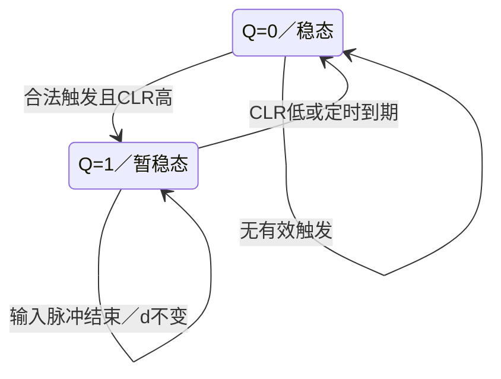

<!-- blog2-digital-logic-note -->

> [!abstract] 定位
> 习题册答案11-1补存题干指定型号；题目原第10章从10-2开始。教材§9.4以此芯片说明集成单稳。

[← 返回本章芯片索引](/blog_test2/blog/%E5%AD%A6%E4%B9%A0%E7%AC%94%E8%AE%B0/%E6%95%B0%E7%94%B5/50-ch09-00_%E6%9C%AC%E7%AB%A0%E8%8A%AF%E7%89%87%E7%B4%A2%E5%BC%95/) · [方程与图表读法](/blog_test2/blog/%E5%AD%A6%E4%B9%A0%E7%AC%94%E8%AE%B0/%E6%95%B0%E7%94%B5/02-02_%E6%96%B9%E7%A8%8B%E4%B8%8E%E5%9B%BE%E8%A1%A8%E8%AF%BB%E6%B3%95/)

## 1. 概念与功能

可重触发单稳，一次有效边沿使Q输出定时正脉冲；脉冲可被后续有效触发延长，也可由低有效CLR提前结束。内部有10kΩ定时电阻。

## 2. 符号图与端口

| 端名（脚号） | 作用 |
| --- | --- |
| $\overline{R}$（5） | 低有效直接清零；满足条件时其上升沿也可触发 |
| $\overline{A_1},\overline{A_2}$（1、2） | 下降沿触发输入，须满足其余端条件 |
| $B_1,B_2$（3、4） | 上升沿触发输入，须满足其余端条件 |
| $Q,\overline Q$（8、6） | 正脉冲及反相输出 |
| $C_{\mathrm{ext}}$（11）、$R_{\mathrm{ext}}/C_{\mathrm{ext}}$（13） | 定时电容及外阻连接 |
| $R_{\mathrm{int}}$（9） | 内部10kΩ电阻端 |
| $V_{\mathrm{CC}}$、GND（14、7） | 电源、地 |

*图9.4.3：印刷305／PDF322。*

## 3. 真值表与功能表

下表的A1/A2使用端口电平。教材表上的上方横线／输入圆圈表示低有效触发路径，不是把0／1再取反。

| CLR_n | A/B事件或条件 | 动作 |
| --- | --- | --- |
| 0 | × | 异步清零，正在输出的脉冲立即截断 |
| 1 | B1↑且B2=1，或B2↑且B1=1；至少一A为0 | 触发／满足重触发间隔时再触发 |
| 1 | 一A↓且另一A=1，或两A同时↓；两B=1 | 触发／重触发 |
| ↑ | 至少一A=0，两B=1 | 触发 |
| 1 | 没有有效新触发 | 既有脉冲继续计时，随后超时回0 |

> [!example]- 教材原表（须同时读TI脚注）
> 

**修正旧卡**：A1＝A2＝1或任一B＝0，不是异步强制清零。TI表这些L/H行有†：该稳态组合已维持足够久，以前开始的脉冲已经完成。只有CLR低可直接截断。[TI SDLS043，第1–3页](https://www.ti.com/lit/ds/symlink/sn74123.pdf#page=2)

## 4. 驱动、输出与状态方程

**有效触发事件**：$E=(A_1\downarrow\land A_2=1)\lor(A_2\downarrow\land A_1=1)\lor(A_1,A_2同时下降)$，且B1＝B2＝1、CLR高；或任一A低、另一个B保持高时B上升；或任一A低且两B高时CLR上升。

**输出**：$Q=1$为暂稳态，$\overline Q=\neg Q$；有效CLR低使Q立即回0。

**行为更新**：设到期时刻为$d$。一次被接受的触发在$t$时刻令$Q^+=1,d^+=t+t_w$；无新触发且$t<d$时Q保持；到期且未被重触发／清零时Q回0；CLR低优先令Q为0。这个到期模型只用于已规定$t_w$及重触发间隔满足要求的理想例，不是芯片模拟充电内部方程。

**定时依据**：

*图9.4.4：印刷307／PDF324。*

教材在$V_{\mathrm{CC}}=5\mathrm V,\ C_{\mathrm{ext}}\ge1000\mathrm{pF}$时采用
$$
t_w=K R_{\mathrm{ext}}C_{\mathrm{ext}}
$$
$K$取教材图9.4.5；$C_{\mathrm{ext}}=1000\mathrm{pF}$时教材给$K=0.45$。采用内阻时以$R_{\mathrm{int}}$代替外阻。更小电容条件的估算式另列于教材PDF323，不与大电容式混用。

## 5. 状态转移表

离散Q之外还需连续定时信息d；以下不是仅靠Q就完备的内部FSM。

| 当前 | 事件 | 后续 |
| --- | --- | --- |
| Q任意 | CLR低 | Q=0，当前脉冲终止 |
| Q=0 | 合法触发 | Q=1，启动定时 |
| Q=1 | 合法重触发，间隔符合要求 | Q=1，更新到期时刻 |
| Q=1 | 触发输入恢复而未形成新有效边沿 | Q保持1，原定时继续 |
| Q=1 | 定时到期 | Q=0 |
| Q=0 | 无有效事件 | Q保持0 |

## 6. 状态转移图

已给定单稳定时模型的输出行为图；重触发有最小间隔，内部RC状态未枚举。

## 7. 波形与时序

**自编核验，非教材／真题波形**。给定每次有效触发对应$t_w=5ms$，初态Q＝0，沿间隔满足手册限制；只忽略数字传播延迟，不忽略定时时长。A2＝B1＝B2＝1，A1为窄负脉冲。 t＝6–7ms强制CLR低；所有表值在事件发生后观察。

| t(ms) | A1 | CLR_n | Q（事件后） | 说明 |
| --- | --- | --- | --- | --- |
| 0 | 1 | 1 | 0 | 已在稳态 |
| 1 | 0 | 1 | 1 | 触发，原计划6ms结束 |
| 2 | 1 | 1 | 1 | 输入脉冲结束，Q继续 |
| 3 | 0 | 1 | 1 | 重触发，计划延至8ms |
| 4 | 1 | 1 | 1 | 输入恢复，仍继续 |
| 6 | 1 | 0 | 0 | CLR截断 |
| 7 | 1 | 1 | 0 | 两A高，释放CLR不触发 |
| 8 | 0 | 1 | 1 | 新触发 |
| 9 | 1 | 1 | 1 | 输入恢复 |
| 13 | 1 | 1 | 0 | 超时 |

## 8. 级联与例子

**两片单稳串接（非进位级联）**：第一级Q接第二级B1；第二级B2＝1、A1＝0、A2＝1、CLR高。两级初始已在稳态，给第一级一次有效触发，若已确定$t_{w1}=1ms,t_{w2}=3ms$，则Q1在0–1ms为高，Q2在0–3ms为高。Q1在1ms回低不会把第二级脉冲清掉。这是边沿触发扩宽，不是两个脉宽相加。

## 9. 常考题型与例题分析

1. **由RC算暂稳态**：识别内阻／外阻接法，统一单位，按题给系数或对应条件计算。补存题干11-1<small>（本地资料未发布）</small>
2. **核验题解系数与单位**：该原答案在等式中同时出现0.32与0.7，结果标0.32ms；不能把矛盾等式当作通用公式。11-1原稿黄底公式<small>（本地资料未发布）</small>

> [!tip] 区别提醒
> 555单稳的$1.1RC$不能移给74LS122；74LS123输入端分组也不能直接照抄本芯片的四个触发输入。

**真实例题：答案补存11-1。** 原题$R=10kΩ,C=100nF$。先算$RC=1ms$；原答案等式同时写0.32与0.7，却给0.32ms。取K＝0.32得0.32ms，K＝0.7应得0.7ms；不能把矛盾转抄成“芯片固定系数”。计算前先确定所用型号／RC条件与系数依据。

**自编核验例（非真题）**：已知每次有效触发后的独立脉宽5ms，t＝1及3ms各触发一次，则没有CLR时Q持续至8ms；t＝6ms施加CLR低，实际高电平1–6ms共5ms。图中t＝2／4恢复A输入都不清零。

## 10. 易错点与教材依据

§9.4.1–9.4.2，图9.4.3、表9.4.1、图9.4.4及9.4.5，印刷305–308／PDF322–325。
教材原PDF第322页<small>（本地资料未发布）</small>

厂商核验：[TI SDLS043，第1–3页](https://www.ti.com/lit/ds/symlink/sn74123.pdf#page=2)，第2页†稳态脚注与触发／清零表，第3页逻辑图；不将稳态表误读为异步复位。原答案0.32／0.7冲突必须保留。
