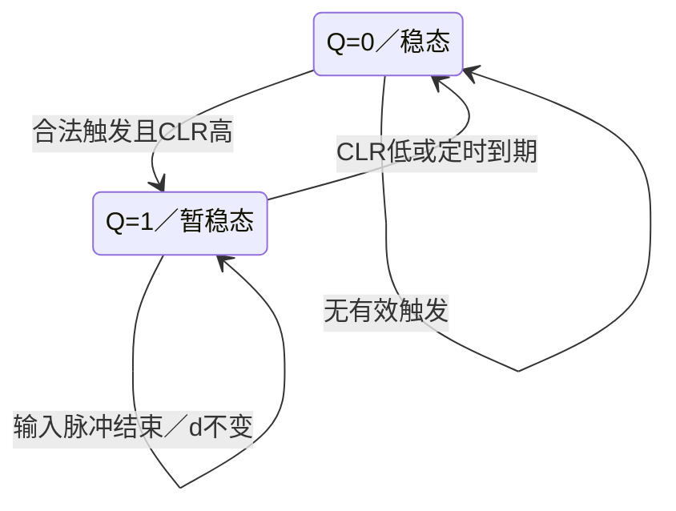

<!-- blog2-digital-logic-note -->

> [!abstract] 定位
> 教材对应器件。§9.4列为可重触发单稳，§11.6数字频率计实际采用；当前题源扫描未核实指定74LS123型号的考试题。

[← 返回本章芯片索引](/blog_test2/blog/%E5%AD%A6%E4%B9%A0%E7%AC%94%E8%AE%B0/%E6%95%B0%E7%94%B5/50-ch09-00_%E6%9C%AC%E7%AB%A0%E8%8A%AF%E7%89%87%E7%B4%A2%E5%BC%95/) · [方程与图表读法](/blog_test2/blog/%E5%AD%A6%E4%B9%A0%E7%AC%94%E8%AE%B0/%E6%95%B0%E7%94%B5/02-02_%E6%96%B9%E7%A8%8B%E4%B8%8E%E5%9B%BE%E8%A1%A8%E8%AF%BB%E6%B3%95/)

## 1. 概念与功能

一封装含两路可重触发单稳，产生互补定时输出。定时与清零机制同属边沿／时间控制，不能当作D触发器或计数器。

## 2. 符号图与端口

下表按TI的D/J/N封装资料，而不是教材频率计的错误标号：

| 端口 | 第1路脚号 | 第2路脚号 | 作用 |
| --- | --- | --- | --- |
| A／B | 1／2 | 9／10 | A下降沿／B上升沿触发，需满足另一输入的门控条件 |
| CLR_n | 3 | 11 | 低有效优先清零；满足条件时释放上升沿也可触发 |
| Q／Q̅ | 13／4 | **5／12** | 正／反向输出 |
| Cext | 14 | 6 | 定时电容端 |
| Rext/Cext | 15 | 7 | 外阻／电容连接端 |
| 电源／地 | 16／8 | 共用 | Vcc／GND |

*厂商SDLS043第3页，不是教材原图；与同型号封装第1页交叉核对。* [TI SDLS043，第1–3页](https://www.ti.com/lit/ds/symlink/sn74123.pdf#page=2)

> [!warning] 原教材图两处边界
> 图11.6.3把第二路12脚标为2Q；TI规定12是反相Q̅，正Q在5脚。不能按这个错标判断触发边沿／清零门极性。另外74LS90原图两清零端有一端接地，不能满足两端同时高的清零条件；“先锁存后清零”是教材预期顺序，不是原图无误的结论。
>
> [频率计原图核对](/blog_test2/blog/%E5%AD%A6%E4%B9%A0%E7%AC%94%E8%AE%B0/%E6%95%B0%E7%94%B5/60-ch11-%E6%95%B0%E5%AD%97%E9%A2%91%E7%8E%87%E8%AE%A1%E8%8A%AF%E7%89%87%E6%90%AD%E9%85%8D/)

> [!example]- 保留原教材频率计图，供核对错标
> 
>
> 印刷375／原PDF392。

## 3. 真值表与功能表

每一路分别满足下列条件；这是压缩事件表，未触发不等于立刻输出0。

| CLR_n | A | B | 结果 |
| --- | --- | --- | --- |
| 0 | × | × | 异步清零，Q=0，Q̅=1 |
| 1 | ↓ | 1 | 触发／满足间隔的重触发 |
| 1 | 0 | ↑ | 触发／满足间隔的重触发 |
| ↑ | 0 | 1 | 触发 |
| 1 | 无有效事件 | 无有效事件 | 已开始的脉冲继续，超时后Q=0 |

TI功能表A高或B低的稳态低输出行带†脚注：保持条件足够久使之前脉冲完成；**不是A升高／B降低就异步截断**。[TI SDLS043，第1–3页](https://www.ti.com/lit/ds/symlink/sn74123.pdf#page=2)

## 4. 驱动、输出与状态方程

**有效触发事件**：$E=(A\downarrow\land B=1)\lor(B\uparrow\land A=0)\lor(\mathrm{CLR}\uparrow\land A=0\land B=1)$，A／B触发还要求CLR高。

**输出**：$Q=1$为暂稳态，$\overline Q=\neg Q$；有效CLR低使Q立即回0。

**行为更新**：设到期时刻为$d$。一次被接受的触发在$t$时刻令$Q^+=1,d^+=t+t_w$；无新触发且$t<d$时Q保持；到期且未被重触发／清零时Q回0；CLR低优先令Q为0。这个到期模型只用于已规定$t_w$及重触发间隔满足要求的理想例，不是芯片模拟充电内部方程。

**定时依据**：两路分别用外部RC定时。$t_w=KRC$只是选定参数范围后的近似形式，K必须来自所用型号／条件，不能借用122或555系数。教材频率计标两路0.02s，本卡不由图内RC外推统一K。

## 5. 状态转移表

离散Q之外还需连续定时信息d；以下不是仅靠Q就完备的内部FSM。

| 当前 | 事件 | 后续 |
| --- | --- | --- |
| Q任意 | CLR低 | Q=0，当前脉冲终止 |
| Q=0 | 合法触发 | Q=1，启动定时 |
| Q=1 | 合法重触发，间隔符合要求 | Q=1，更新到期时刻 |
| Q=1 | 触发输入恢复而未形成新有效边沿 | Q保持1，原定时继续 |
| Q=1 | 定时到期 | Q=0 |
| Q=0 | 无有效事件 | Q保持0 |

## 6. 状态转移图

已给定单稳定时模型的输出行为图；重触发有最小间隔，内部RC状态未枚举。

## 7. 波形与时序

**自编核验，非教材／真题波形**。给定每次有效触发对应$t_w=5ms$，初态Q＝0，沿间隔满足手册限制；只忽略数字传播延迟，不忽略定时时长。A恒0，B为窄正脉冲。 t＝6–7ms强制CLR低；所有表值在事件发生后观察。

| t(ms) | B | CLR_n | Q（事件后） | 说明 |
| --- | --- | --- | --- | --- |
| 0 | 0 | 1 | 0 | A恒0，已在稳态 |
| 1 | 1 | 1 | 1 | B↑触发，原计划6ms结束 |
| 2 | 0 | 1 | 1 | B脉冲结束，Q继续 |
| 3 | 1 | 1 | 1 | 重触发，延至8ms |
| 4 | 0 | 1 | 1 | B恢复低不清零 |
| 6 | 0 | 0 | 0 | CLR截断 |
| 7 | 0 | 1 | 0 | B为0，释放CLR不触发 |
| 8 | 1 | 1 | 1 | 新B↑ |
| 9 | 0 | 1 | 1 | 继续计时 |
| 13 | 0 | 1 | 0 | 超时 |

## 8. 级联与例子

**一封装两路串接例（顺序脉冲）**：第1路Q(13脚)接第2路A(9脚)，两B接高，两CLR高。两路均已进入稳态，初始Q1＝Q2＝0；第1路一次触发，已确定$t_{w1}=2ms,t_{w2}=3ms$。Q1上升时第2路A↑不触发；Q1于2ms下降，第2路触发，Q2从2ms高至5ms。取Q2必须接5脚，接12脚得到反向脉冲。初始化产生的可能脉冲需先结束，不能省略初态条件。

**教材应用**：两单稳用于“锁存、后清零”的控制序列；原频率计有输出错标及90清零接线疑点，不能据此宣称原图直接可用。

## 9. 常考题型与例题分析

以下是**同类时序关系训练**，原题没有指定74LS123，不能据此宣称考过该型号。

1. **单稳定时与触发控制**：先检查触发条件，再算RC；两芯片系数应分别取题给依据。11-1（原题指定74LS122）<small>（本地资料未发布）</small>
2. **测量窗口与计数**：窗口时间内统计时钟脉冲，按$N=fT_g$求被测量。827·2015测量电路（555定时）<small>（本地资料未发布）</small>

> [!tip] 区别提醒
> “可重触发”描述单稳输出的延长机制，不代表输入一变就触发；A、B、清零条件必须同时满足。不能用74LS122端名或功能表冒充74LS123完整手册表。

**真实训练入口：827·2015第十题（原题555定时）。** 考测量窗口与计数，题目没有指定123；传感器每转一个脉冲，窗口高电平60s，计到N个脉冲即N转／分。解题先定窗口，再判计数／锁存／清零的先后，不能凭“单稳”型号补不存在的题意。

**自编核验例（非真题）**：第8节两路宽2、3ms，正向Q2开始时间2ms、结束5ms；若将13脚误当成12脚类推，或将第2路错误取12脚，将把正负沿与输出极性倒置。

## 10. 易错点与教材依据

§9.4集成单稳型号分类（印刷305／PDF322）；§11.6，图11.6.3–11.6.4（印刷375–376／PDF392–393）。
教材原PDF第392页<small>（本地资料未发布）</small>

厂商核验：[TI SDLS043，第1–3页](https://www.ti.com/lit/ds/symlink/sn74123.pdf#page=2)，第2页†稳态脚注与触发／清零表，第3页逻辑图；不将稳态表误读为异步复位。教材频率计12脚输出错标、74LS90清零接线疑点均保留。
