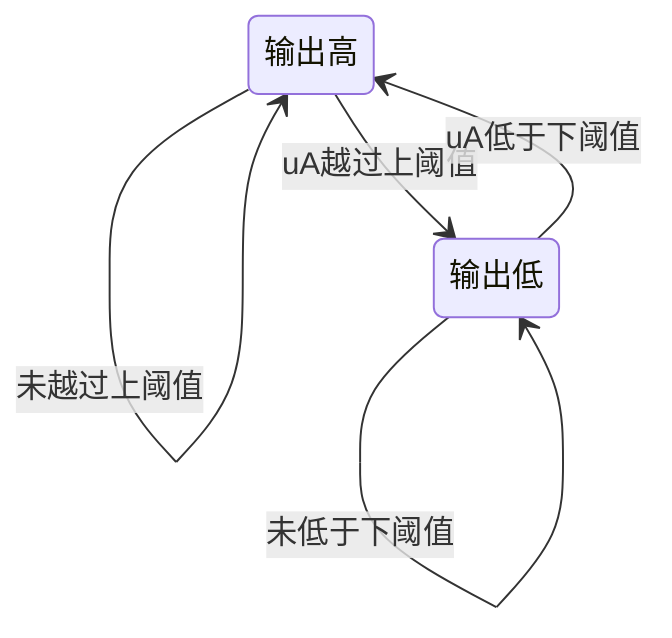

<!-- blog2-digital-logic-note -->

> [!abstract] 定位
> 教材对应器件。有完整教材引脚／逻辑图；当前题源未核实直接指定此型号的考试题。以施密特整形方法关联习题。

[← 返回本章芯片索引](/blog_test2/blog/%E5%AD%A6%E4%B9%A0%E7%AC%94%E8%AE%B0/%E6%95%B0%E7%94%B5/50-ch09-00_%E6%9C%AC%E7%AB%A0%E8%8A%AF%E7%89%87%E7%B4%A2%E5%BC%95/) · [方程与图表读法](/blog_test2/blog/%E5%AD%A6%E4%B9%A0%E7%AC%94%E8%AE%B0/%E6%95%B0%E7%94%B5/02-02_%E6%96%B9%E7%A8%8B%E4%B8%8E%E5%9B%BE%E8%A1%A8%E8%AF%BB%E6%B3%95/)

## 1. 概念与功能

四个2输入施密特与非门。对明确的0／1输入满足与非逻辑；对缓变模拟输入有回差，转折阈值依变化方向及前一输出而异。不能当作时钟寄存器，也不能忽略回差。

## 2. 符号图与端口

| 门组 | 输入脚 | 输出脚 |
| --- | --- | --- |
| 第1门 | 1、2 | 3 |
| 第2门 | 4、5 | 6 |
| 第3门 | 10、9 | 8 |
| 第4门 | 13、12 | 11 |
| 电源 | 14接电源、7接地 | — |

*图9.3.7(b)：印刷303／PDF320，门内小符号表示滞回特性。*

## 3. 真值表与功能表

$$
Y=\overline{AB}
$$

| A | B | 稳定逻辑输出Y |
| --- | --- | --- |
| 0 | 0 | 1 |
| 0 | 1 | 1 |
| 1 | 0 | 1 |
| 1 | 1 | 0 |

此表只描述明确高／低逻辑电平。将两输入并接，或一输入固定高、另一输入作信号时，形成反相施密特整形：上升越过$U_{T+}$输出低，下降低于$U_{T-}$输出高，中间区保持，$\Delta U_T=U_{T+}-U_{T-}$。具体阈值依型号参数，**不用555的1/3、2/3电源阈值替代**。

## 4. 驱动、输出与状态方程

**驱动条件**：下面行为式限定B固定为逻辑1、A为缓变输入，或A/B并接作为反相施密特。

**输出／历史关系**：
$$
Y^+=\begin{cases}0&u_A>U_{T+}\\1&u_A<U_{T-}\\Y&U_{T-}<u_A<U_{T+}\end{cases}
$$
这说明回差区存在输入历史依赖；不是无回差组合门的$Y=f(u_A)$单值关系，也不表示内部有可编写D／JK驱动的触发器。B固定0时逻辑输出高，不套此B＝1专用式。

## 5. 状态转移表

本表是B＝1时的回差输出行为，非时钟触发状态表。普通0／1真值表见第3节。

| 输入区域 | 先前Y | 新Y |
| --- | --- | --- |
| 低于下阈值 | × | 1 |
| 高于上阈值 | × | 0 |
| 中间区 | 0 | 0 |
| 中间区 | 1 | 1 |

未指定阈值精确值前，不能把输入1.2V直接映射成固定高／低。

## 6. 状态转移图

B恒1的回差响应图；不是时钟存储器内部FSM。

## 7. 波形与时序

**自编核验，非型号参数测试**。仅为算例假定$U_{T+}=1.6V,U_{T-}=0.8V$，不是74LS132保证参数。B恒1，初始A＝0、Y＝1。输入在相邻整数时刻间保持不变，整数时刻发生阶跃；跨阈值瞬间翻转，忽略传播延迟。表值为阶跃后观察值。

| t | A/V | Y | 第2门Z |
| --- | --- | --- | --- |
| 0 | 0 | 1 | 0 |
| 1 | 0.6 | 1 | 0 |
| 2 | 1.2 | 1 | 0 |
| 3 | 2 | 0 | 1 |
| 4 | 1.4 | 0 | 1 |
| 5 | 0.7 | 1 | 0 |
| 6 | 0.4 | 1 | 0 |
| 7 | 1.3 | 1 | 0 |
| 8 | 2 | 0 | 1 |

## 8. 级联与例子

**两门串接复合例**：第1门B1固定高，A1接缓变输入；Y1接第2门A2，B2固定高。两级输出电平跨过后级阈值且忽略延迟时，$Z=\overline{Y_1}$，形成非反相整形，保持第1级回差的翻转时刻。不是两输出并接。第7节整数时刻Z为0、0、0、1、1、0、0、0、1。

**计算**：假定阈值回差$\Delta U=1.6-0.8=0.8V$；先前Y为0时输入降至1.4V仍保持0，不能按固定1.2V门限翻转。

## 9. 常考题型与例题分析

以下为同类施密特题，原题用555，训练方法可迁移而器件参数不能迁移。

1. **画带回差传输特性及波形**：按输入变化方向分别用上、下阈值。习题册10-5<small>（本地资料未发布）</small>
2. **判断尖峰是否被识别**：越过上阈值后，还要降到下阈值才能为下一次转换复位。习题册10-4<small>（本地资料未发布）</small>

> [!tip] 区别提醒
> 74LS14是六反相施密特器件；74LS132是四2输入施密特与非门，不能互换引脚图。教材图9.3.7(a)实际是CD40106，不是74LS14。

**真实训练：习题册10-5（原器件555）。** 考传输回差和尖峰识别。步骤：①标上／下阈值；②按时间顺序跟踪输出旧态；③越过上阈值后，必须先降过下阈值才能恢复，为下一尖峰准备；④本型号阈值不能直接抄555比例。

**自编核验例（非真题）**：本卡t＝4输入1.4V在回差区，Y保持此前0；t＝5输入0.7V才回高。该现象不能用仅有稳定逻辑输入的四行与非表解释。

## 10. 易错点与教材依据

§9.3.3，图9.3.7(b)（印刷303／PDF320）；反相施密特传输特性见§9.3.1–9.3.2。
教材原PDF第320页<small>（本地资料未发布）</small>

74LS14为六反相施密特，132为四2输入施密特与非；不能互换引脚。教材CD40106阈值表也不是132的参数表。
