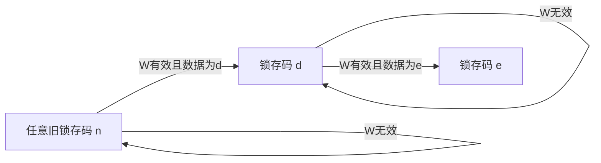

<!-- blog2-digital-logic-note -->

> [!abstract] 定位
> 题目指定型号。R–2R电阻网络＋数据锁存器；原芯片输出电流，题里的电压输出要结合外部运放接法。

[← 返回本章芯片索引](/blog_test2/blog/%E5%AD%A6%E4%B9%A0%E7%AC%94%E8%AE%B0/%E6%95%B0%E7%94%B5/55-ch10-00_%E6%9C%AC%E7%AB%A0%E8%8A%AF%E7%89%87%E7%B4%A2%E5%BC%95/) · [方程与图表读法](/blog_test2/blog/%E5%AD%A6%E4%B9%A0%E7%AC%94%E8%AE%B0/%E6%95%B0%E7%94%B5/02-02_%E6%96%B9%E7%A8%8B%E4%B8%8E%E5%9B%BE%E8%A1%A8%E8%AF%BB%E6%B3%95/)

## 1. 概念与功能

8位电流输出型DAC，含数据锁存器与R–2R电阻网络；有256种数字码。把锁存器中的码转换为模拟量，外部运放接法决定电压输出比例及极性。它既不是无存储的纯组合器件，也不是接CP逐次计数的器件。

## 2. 符号图与端口

| 端名（脚号） | 作用 |
| --- | --- |
| DB7～DB0（4～11） | 8位输入，DB7最高位 |
| $\overline{CS},\overline{WR}$（12、13） | 低有效片选／写命令 |
| $V_{\mathrm{REF}}$（15） | 参考电压，勿与供电$V_{\mathrm{DD}}$混同 |
| OUT1、OUT2（1、2） | 电流输出端，图10.3.4分别接运放反相端／地 |
| $R_{\mathrm{FB}}$（16） | 内部反馈电阻端，典型接法接运放输出 |
| $V_{\mathrm{DD}}$、GND（14、3） | 电源、地 |

*图10.3.3(b)：印刷335／PDF352。*

> [!example]- 展开内部R–2R网络与数据锁存器
> 
>
> *图10.3.3(a)：印刷335／PDF352。*

## 3. 真值表与功能表

| $\overline{CS}$ | $\overline{WR}$ | 数据锁存器 |
| --- | --- | --- |
| 0 | 0 | 写入输入数据并供DAC输出 |
| 0 | 1 | 保持 |
| 1 | 0 | 保持 |
| 1 | 1 | 保持 |

> [!example]- 展开教材原功能表
> 
>
> *表10.3.2：印刷336／PDF353，已核对CS、WR反线。*

## 4. 驱动、输出与状态方程

**写入驱动条件**：$W=\neg\overline{CS}\land\neg\overline{WR}$；两个端口逻辑值均0才有效。这是电平写窗口，不凭空指定为某个单独时钟上升沿。

**锁存状态关系**：设N为锁存8位码，$N^+=D$（W有效并满足数据／时序要求）；W无效时$N^+=N$。本卡没有假设上电N自动清0，芯片也未在题中给出清零引脚。

**输出方程**（图10.3.4，内部反馈电阻，理想运放）：$u_O=-V_{\mathrm{REF}}N/256$。D已变化但锁存器保持时，应使用N而不是外部新D。

*图10.3.4：印刷336／PDF353。*

在图示运放接法、使用内部反馈电阻、理想线性工作条件下，$n_i$为锁存位：写窗口有效且满足时序时$n_i=D_i$，保持时$n_i$不变。以下N始终是锁存码，不是任意时刻的外部输入码：
$$
N=\sum_{i=0}^{7}n_i2^i,\qquad u_O=-\frac{V_{\mathrm{REF}}}{256}N
$$
$$
U_{\mathrm{LSB}}=\frac{|V_{\mathrm{REF}}|}{256},\quad |u_{O,\max}|=\frac{255}{256}|V_{\mathrm{REF}}|
$$

| 指标写法 | 本卡的含义 |
| --- | --- |
| 8位 | 256种数字码 |
| LSB，单位mV或V | 相邻输出码的电压增量 |
| 教材相对分辨率 | $U_{\mathrm{LSB}}/|u_{O,\max}|=1/255$ |
| 对参考范围归一化 | $U_{\mathrm{LSB}}/|V_{\mathrm{REF}}|=1/256$ |

题目问“分辨率”先看单位和定义；以上两种百分比归一化分母不能混用。电压变化范围也不等于转换误差或转换速度。

## 5. 状态转移表

锁存器有256种状态，可用完备的压缩规则代替256×256展开表。

| 当前N | 条件 | 输入D | 后续N |
| --- | --- | --- | --- |
| 任意 | W有效、数据满足时序 | d | d |
| n | W无效 | 任意 | n |
| 00H | W有效 | 80H | 80H |
| 80H | W无效 | FFH | 80H |
| 80H | W有效 | FFH | FFH |

这描述外部可见锁存状态，不声称已知内部各触发器D／JK驱动或晶体管网表。

## 6. 状态转移图

锁存码的参数化行为关系图，n/d/e可取00–FFH；不是仅列3个真实状态的完整枚举图。

## 7. 波形与时序

**自编核验、非厂家原时序**。图10.3.4接法，VREF＝5V，初始锁存N＝00H由题设给定；图中DB7在前。建立／保持已满足，忽略数字及模拟建立时间；控制窗改变时按有效写／保持规则观察。输入C0H在t＝3先出现，t＝4才开启写窗口，因此3–4输出仍为−1.25V。

| 区间 | CS_n/WR_n | D | N | uO/V |
| --- | --- | --- | --- | --- |
| 0–1 | 11 | 00H | 00H | 0 |
| 1–2 | 00 | 40H | 40H | −1.25 |
| 2–3 | 01 | 40H | 40H | −1.25 |
| 3–4 | 01 | C0H | 40H | −1.25 |
| 4–5 | 00 | C0H | C0H | −3.75 |
| 5–6 | 10 | 80H | C0H | −3.75 |

## 8. 级联与例子

**计数器→DAC串接例**：两片74LS161共CP；低级EP＝ET＝1，高级EP＝1、ET接低级RCO；清零／装入按正常计数条件，低4位接DB3…DB0，高4位接DB7…DB4。若AD7524持续写，理想得到8位锯齿码；真实硬件宜在计数输出稳定后用写脉冲锁存，避免过渡码毛刺。

若CP＝10kHz，256码循环周期25.6ms、重复频率39.0625Hz；VREF＝5V时输出从0至$-255×5/256=-4.98046875V$，每步−19.53125mV。两级计数是进位扩展，计数器接DAC是串接复合；DAC电流输出不随意并接。

## 9. 常考题型与例题分析

1. **由连接码算负电压、LSB**：先辨DB7／DB0再换十进制，供电不自动充当参考。2020秋·一7<small>（本地资料未发布）</small>
2. **已知某一位输出反推参考量**：由$D_6=1$时电压，求LSB，再按计数器循环画DAC波形。2011秋·三<small>（本地资料未发布）</small>
3. **与计数器／555综合**：独立核实计数模数、数字码与模拟输出；10000000是半参考幅度，不是满码。827·2014第八题<small>（本地资料未发布）</small>
4. **按给定码求输出**：先核对片选／写入使能，再按图示输入码的位权计算。827·2019填空5<small>（本地资料未发布）</small>

> [!tip] 易混点
> AD7524典型反相输出带负号；外部运放和反馈电阻若换接，先重建电流—电压关系，不能背负号后忽略题图。

**真实例题：2011秋·三。** 已知仅D6＝1输出−1V。①该码N＝64；②单位码输出−1/64＝−15.625mV；③反推VREF＝4V；④再按计数器有效状态序列逐码画波形。不能用“8位满量程”直接把−1V当LSB。

**自编核验例（非真题）**：VREF＝5V且W无效，旧码40H、新外部码C0H；输出保持−1.25V。W再次有效后为−3.75V。满码为−4.98046875V，不是−5V。

## 10. 易错点与教材依据

§10.3.2，图10.3.3、10.3.4及表10.3.2（印刷335–336／PDF352–353）；§10.3.3分辨率与转换误差（印刷336–338／PDF353–355）。
教材原PDF第352页<small>（本地资料未发布）</small>

区分码宽、LSB电压、相对分辨率、建立时间及转换误差；锁存窗口与计数CP不应混写。
