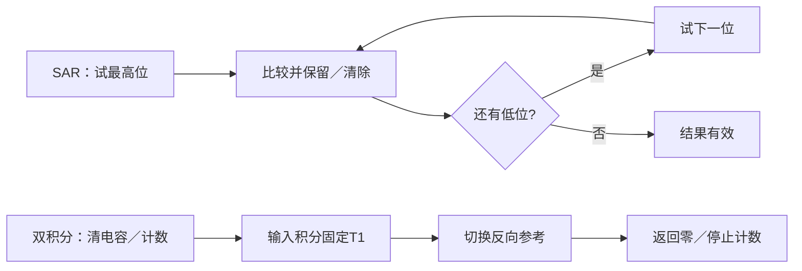
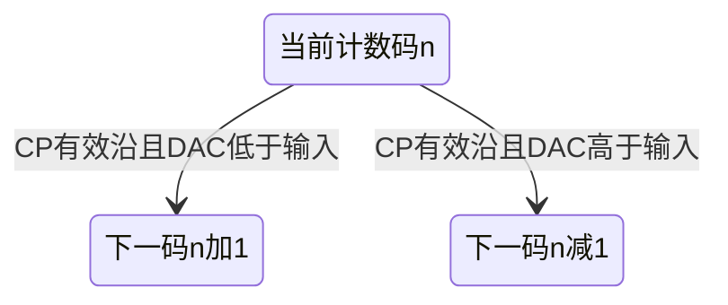

<!-- blog2-digital-logic-note -->

> [!abstract] 定位
> 通用电路卡。题源指定的是转换结构与参数，不能把所有题图都称为ADC0809。各结构使用自己的转换关系与时序。

[← 返回本章芯片索引](/blog_test2/blog/%E5%AD%A6%E4%B9%A0%E7%AC%94%E8%AE%B0/%E6%95%B0%E7%94%B5/55-ch10-00_%E6%9C%AC%E7%AB%A0%E8%8A%AF%E7%89%87%E7%B4%A2%E5%BC%95/) · [方程与图表读法](/blog_test2/blog/%E5%AD%A6%E4%B9%A0%E7%AC%94%E8%AE%B0/%E6%95%B0%E7%94%B5/02-02_%E6%96%B9%E7%A8%8B%E4%B8%8E%E5%9B%BE%E8%A1%A8%E8%AF%BB%E6%B3%95/)

## 1. 概念与功能

同为ADC但判码／计时机制不同：并行比较靠阈值与编码器，SAR逐位试探，双积分把电压变时间，跟踪型每拍加减一码。位数、LSB、速度、量化误差和采样条件要分别确定。

## 2. 符号图与端口

| 电路 | 关键端／状态 | 解题入口 |
| --- | --- | --- |
| 并行比较 | 模拟输入、阶梯参考、比较器输出、编码器输出 | 阈值→温度计码→二进制码 |
| SAR | 模拟输入、DAC试探电压、比较结果、CP及控制状态 | 从MSB逐位保留／清除 |
| 双积分 | 输入／反向参考选择、复位开关、积分输出、计数时钟 | 定时积分→反向积分至零 |
| 跟踪 | 输入、DAC反馈、比较器、可逆计数控制、CP | 比较器决定每拍加／减1 |

> [!example]- 教材逻辑图10.4.5
> 
>
> *印刷341／PDF358，3位示例含7个比较器；原图阈值为奇数倍$V_{\mathrm{REF}}/15$。*

> [!example]- 教材逻辑图10.4.7
> 
>
> *印刷343／PDF360。图中3位数据寄存器配5级环形控制器，不能只数3个时钟就断言全过程结束。*

*印刷345／PDF362。*

*原PDF42。*

## 3. 真值表与功能表

压缩功能规则，不给四种结构捏造同一布尔真值表。

| 结构 | 完备压缩判定 |
| --- | --- |
| 并行 | 在每相邻阈值划分区间内，先求比较器温度计码，再按编码器极性输出 |
| SAR | 试探电压≤输入保留本位1，否则清0 |
| 双积分 | 第一阶段接输入固定T1；第二阶段接反极性参考直至积分输出回零 |
| 跟踪 | DAC低于输入则加1，高于输入则减1；相等和边界依比较器／计数器表 |

并行$n$位通常需$2^n-1$个比较器；阈值由实际电阻网络而不是一律$V_{\mathrm{REF}}/2^n$决定。

## 4. 驱动、输出与状态方程

**驱动条件**：分别查CP、比较器极性、控制开关、计数器使能及初态；没有统一的“ADC内部D驱动式”。

**输出／行为**：
- 并行：$D=\mathrm{Encoder}(C_1,\ldots,C_{2^n-1})$，含寄存器时还要按其时钟采样。
- SAR：第k次令待试位为1得试码T，按比较结果令保留码$N^+=T$或旧N；完整转换时间取控制图，教材特定循环为$(n+2)T_{\mathrm{CP}}$。
- 双积分（同积分电阻、输入近似恒定、参考极性相反）：$T_1=N_1/f_{\mathrm{CP}}$，$T_2/T_1=|u_I|/|V_{\mathrm{REF}}|$，理想连续计数$D_n=N_1|u_I|/|V_{\mathrm{REF}}|$。两路电阻不同时还乘正确电阻比。
- 跟踪：有效CP沿后$N^+=N+1$或$N-1$，方向由比较器及计数控制表共同确定；边界按实际计数器回卷／饱和。$u_{\mathrm{DAC}}=\Delta N$，理想跟踪斜率约$\Delta f_{\mathrm{CP}}$。

数字码必须为整数；双积分计数门的最后脉冲与比较器关门先后不能从连续计数小数直接四舍五入。

## 5. 状态转移表

**操作／行为对照，不是所有ADC共享的内部状态表**：

| 结构／当前阶段 | 条件 | 后续 |
| --- | --- | --- |
| 无寄存的并行比较 | 输入跨阈值 | 编码改变，无需人为加内部存储状态 |
| SAR试某位 | 比较结束 | 保留／清除该位，试下一位 |
| SAR末位完成 | 控制器允许输出 | 锁存或送出结果 |
| 双积分采样 | 固定N1个脉冲结束 | 切换反极性参考 |
| 双积分反积分 | 回零比较器动作 | 停止计数，结果有效 |
| 跟踪N | 有效CP沿 | 按方向变成N±1 |

SAR控制阶段还含保留码；双积分含连续积分电压；跟踪含计数器状态，不能仅列几个阶段就宣称完整状态空间。

## 6. 状态转移图

SAR与双积分的算法／操作流程，不是芯片内部触发器级完整状态机。

跟踪计数的参数化一步关系；各n可取所有合法码，边界回卷由计数器决定，不只存在图中3态。

## 7. 波形与时序

以下均为**自编核验，非原教材波形**；模拟输入已满足稳定条件，忽略比较器／数字／模拟建立延迟。位序均MSB在前，时间仅为所声明事件或CP周期，不把算法步骤当所有芯片时钟。

**并行例**：3位，阈值0.5、1.5…6.5V，输出重建电平为0、1…7V；输入在事件间阶梯保持，因此代码0、1、2、5、6。这是明确中点量化规则，不移用于不同题图。

| uI/V | 0 | 0.8 | 2.2 | 4.8 | 6.4 |
| --- | --- | --- | --- | --- | --- |
| 输出码 | 000 | 001 | 010 | 101 | 110 |

**SAR例**：4位、VREF＝1.6V，LSB＝0.1V，uI＝0.7V，初始保留码0000；假定比较时相等保留。四次试码8、4、6、7，分别清、留、留、留，结果0111。未计初始化、输出与回初态开销。

| 试位 | 试码 | 砝码/V | 决定 | 保留码 |
| --- | --- | --- | --- | --- |
| MSB | 1000 | 0.8 | 清 | 0000 |
| 次位 | 0100 | 0.4 | 留 | 0100 |
| 次位 | 0110 | 0.6 | 留 | 0110 |
| LSB | 0111 | 0.7 | 留 | 0111 |

**双积分例**：N1＝16，fCP＝10kHz，uI＝0.375V，参考反向幅值0.5V，RC＝10ms，初始积分输出0。T1＝1.6ms，积分输出−0.06V；T2＝1.2ms，回零总时长2.8ms，理想计数12＝1100。此例约定边界计数含最后一个使12计数完成的脉冲；真实题要核对门控时序。

| 事件 | t/ms | 积分器输出 | 操作 |
| --- | --- | --- | --- |
| 开始 | 0 | 0V | 接输入 |
| 切换 | 1.6 | −0.06V | 接反向参考 |
| 回零 | 2.8 | 0V | 停计数 |

**跟踪例**：4位，初码0000，Δ＝0.2V，uI＝0.7V；每个CP沿按旧DAC比较结果加／减1。序列0、1、2、3、4、3、4…，反馈在0.6／0.8V间摆动，不是“稳定后完全不动”。

| CP序号 | 0 | 1 | 2 | 3 | 4 | 5 | 6 |
| --- | --- | --- | --- | --- | --- | --- | --- |
| N | 0 | 1 | 2 | 3 | 4 | 3 | 4 |
| DAC/V | 0 | 0.2 | 0.4 | 0.6 | 0.8 | 0.6 | 0.8 |

## 8. 级联与例子

**双积分计数器进位扩展例**：两片4位74LS161按共CP同步级联，构成8位计数器；若固定积分阶段使用256个脉冲、参考1V、输入0.5V，则T2/T1＝1/2，理想结果128＝80H。相比一片4位且用16脉冲，结果8＝8H；同参考下名义输入分辨增量由1/16V降为1/256V，但转换时间随固定计数窗变长，不是免费提速。

**并行比较扩位**：3位到4位比较器由7个增至15个，不能简单把两块3位编码器输出连成6位ADC。

## 9. 常考题型与例题分析

1. **并行比较阈值、输出码、最大量化误差**。2020春·二4<small>（本地资料未发布）</small>
2. **SAR码与转换时间**：读砝码变化，逐位还原代码并核实控制时钟数。习题册11-5<small>（本地资料未发布）</small>
3. **双积分码、时间、扩位及溢出**：先求$N_1$，再定$T_2$和计数码。2019秋·八<small>（本地资料未发布）</small>
4. **跟踪波形、稳定所需周期与预置加速**：依比较器极性逐拍加减，不套SAR逐位决策。2015秋·六<small>（本地资料未发布）</small>

> [!tip] 共通但需分开的指标
> 位数／LSB说明分辨能力；转换时间说明速度；采样频率由信号带宽确定。连续信号采样需满足$f_s>2f_{\max}$，还要保证转换在相应采样周期内完成；三者不能互相替代。

**真实例题：2015秋·六（跟踪型）。** 题给0001产生0.2V，故Δ＝0.2V。①确定DAC电压权重；②按比较器正负端与74LS191控制表决定加／减；③逐拍列码、画阶梯；④输入固定时检查相邻码往返；⑤改变预置初值只能缩短初始距离，不改变LSB。

**另一真实计时边界：习题册11-5。** 8位250kHz原答案36µs为9周期；教材图10.4.7的完整回初态循环按(n+2)需40µs。原题砝码图答案01001111，须逐步验证，不能从“8位”直接决定周期。题册答案12-5，原PDF55<small>（本地资料未发布）</small>

**自编核验例（非真题）**：第7节双积分得12码、2.8ms；若输入超过参考且计数器不能饱和保持，要继续分析回卷与“一次切换”控制，不能把任何超量程值都写成全1。

## 10. 易错点与教材依据

§10.4.1–10.4.4，印刷338–346／PDF355–363；图10.4.5、10.4.7、10.4.9。跟踪结构直接依据2015秋题图8。
教材原PDF第358页<small>（本地资料未发布）</small>

采样$f_s>2f_{\max}$与转换时间约束应分别核对；最大量化误差依阈值／量化规则，不总等于LSB/2。N1按实际初值、计数模数、触发边沿算；频率计等其他计数图的清零接线也须核对，不移用有疑点连线。
