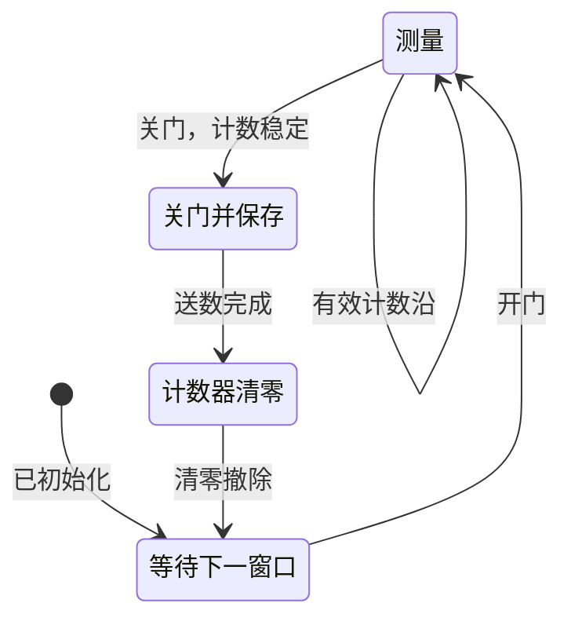

<!-- blog2-digital-logic-note -->

[本章索引](/blog_test2/blog/%E5%AD%A6%E4%B9%A0%E7%AC%94%E8%AE%B0/%E6%95%B0%E7%94%B5/59-ch11-00_%E6%9C%AC%E7%AB%A0%E8%8A%AF%E7%89%87%E7%B4%A2%E5%BC%95/) · [芯片总索引](/blog_test2/blog/%E5%AD%A6%E4%B9%A0%E7%AC%94%E8%AE%B0/%E6%95%B0%E7%94%B5/00-00_%E8%8A%AF%E7%89%87%E6%80%BB%E7%B4%A2%E5%BC%95/) · [方程与图表读法](/blog_test2/blog/%E5%AD%A6%E4%B9%A0%E7%AC%94%E8%AE%B0/%E6%95%B0%E7%94%B5/02-02_%E6%96%B9%E7%A8%8B%E4%B8%8E%E5%9B%BE%E8%A1%A8%E8%AF%BB%E6%B3%95/)

> [!abstract] 题源定位
> 本卡是系统搭配卡。2015年827第十题指定整形、555定时和74LS160千进制计数；教材§11.6用另一套芯片组合演示完整频率计。教材的123、273、48等型号不能因此全部认作该真题指定器件。

## 1. 概念与功能

把被测周期信号整形成脉冲，在已知时间窗内计数，再保持并显示结果。基本关系为$f=N/T$；重点是**窗口内计数、关门后保存、保存后清零**。

| 模块 | 题定或教材对应器件 | 承担功能 |
| --- | --- | --- |
| 整形 | 题目要求施密特功能；[教材对应74LS132](/blog_test2/blog/%E5%AD%A6%E4%B9%A0%E7%AC%94%E8%AE%B0/%E6%95%B0%E7%94%B5/54-ch09-74ls132%E8%8A%AF%E7%89%87/) | 把一个周期变成一个可靠计数脉冲 |
| 定时 | [555](/blog_test2/blog/%E5%AD%A6%E4%B9%A0%E7%AC%94%E8%AE%B0/%E6%95%B0%E7%94%B5/51-ch09-555%E8%8A%AF%E7%89%87/) | 决定测量窗口与更新周期 |
| 计数 | 题定[74LS160](/blog_test2/blog/%E5%AD%A6%E4%B9%A0%E7%AC%94%E8%AE%B0/%E6%95%B0%E7%94%B5/27-ch07-74ls160%E8%8A%AF%E7%89%87/)；教材[74LS90](/blog_test2/blog/%E5%AD%A6%E4%B9%A0%E7%AC%94%E8%AE%B0/%E6%95%B0%E7%94%B5/35-ch07-74ls90%E8%8A%AF%E7%89%87/) | 统计脉冲，按进制级联 |
| 送数、清零 | 教材[74LS123](/blog_test2/blog/%E5%AD%A6%E4%B9%A0%E7%AC%94%E8%AE%B0/%E6%95%B0%E7%94%B5/53-ch09-74ls123%E8%8A%AF%E7%89%87/) | 两路单稳产生先后控制脉冲 |
| 结果保持 | 教材[74LS273](/blog_test2/blog/%E5%AD%A6%E4%B9%A0%E7%AC%94%E8%AE%B0/%E6%95%B0%E7%94%B5/22-ch06-74ls273%E8%8A%AF%E7%89%87/) | 上升沿保存计数值，计数器清零后显示不变 |
| 显示 | 教材[74LS48](/blog_test2/blog/%E5%AD%A6%E4%B9%A0%E7%AC%94%E8%AE%B0/%E6%95%B0%E7%94%B5/19-ch05-74ls48%E8%8A%AF%E7%89%87/) | 把各位BCD转换为共阴极数码管段信号 |

## 2. 符号图与端口

图11.6.1为教材原图（印刷374／原PDF391）。下表使用分析变量，不是新增芯片引脚名。

| 分析变量 | 含义 | 题图中核查什么 |
| --- | --- | --- |
| $X$ | 整形后的被测脉冲 | 周期、有效计数沿及是否一转一脉冲 |
| $G$ | 开门控制，本文1表示允许通过 | 高电平持续时间$T$，不是整个时基周期 |
| $E$ | 门输出 | 与门为$GX$，与非门则极性改变 |
| $C$ | 保存结果的触发信号 | 273在$C\uparrow$采样 |
| $CLR$ | 本文统一定义的高有效计数清零请求 | 160低有效清零端须接$\overline{CLR}$；90须检查两个清零端 |
| $N,L$ | 当前计数／已保存显示值 | 计数器与结果寄存器不是同一组状态 |

## 3. 真值表与功能表

此处是模块控制表，不替代每颗芯片的完整功能表。

| 控制条件 | 当前计数$N$ | 保存值$L$ |
| --- | --- | --- |
| $CLR=1$ | 清零 | 不应随计数器一起被清除 |
| $CLR=0,G=1$且到达有效计数沿 | 加1，超过容量回卷 | 保持 |
| $CLR=0,G=0$，无保存事件 | 保持 | 保持 |
| 关门后$C\uparrow$ | 保持 | 取当前$N$ |

实际清零、置数、使能的优先级，以选用器件功能表为准；本例不让保存与清零同时发生。

## 4. 驱动、输出与状态方程

**驱动条件**：门电路$E=GX$；正确配置的计数链在其有效沿计数；273由$C\uparrow$保存。这里不假设芯片内部JK或D连接。

**状态行为**：计数容量为$M$，在理想离散事件模型中
$$
N^+=\begin{cases}
0,&CLR=1\\
(N+1)\bmod M,&CLR=0\text{且有效计数事件到达}\\
N,&\text{其余情况}
\end{cases}
$$
$$
L^+=\begin{cases}N,&C\uparrow\text{且计数结果已稳定}\\L,&\text{其他时刻}\end{cases}
$$

**输出关系**：各位显示段为$\operatorname{Decode}_{48}(\operatorname{BCDdigit}(L))$。频率与转速分别为
$$
f=\frac{L}{T},\qquad n=\frac{60L}{pT}\;(\mathrm{r/min})
$$
$p$为每转脉冲数。这些是计数与读数模型，不是555或123内部的驱动方程；门边界截断脉冲、传播延迟和溢出需另查。

## 5. 状态转移表

下面按**测量阶段**建模，不是穷举全部计数值和锁存值的完整状态表。

| 当前阶段 | 事件 | 动作 | 下一阶段 |
| --- | --- | --- | --- |
| 测量 | 开门期间到达有效计数沿 | $N\leftarrow N+1$ | 测量 |
| 测量 | 窗口结束 | 关门，等待计数稳定 | 保存 |
| 保存 | 送数有效沿 | $L\leftarrow N$ | 清零 |
| 清零 | 清零脉冲 | $N\leftarrow0$，$L$保持 | 等待 |
| 等待 | 下一窗口开始 | 开门 | 测量 |

## 6. 状态转移图

这是与上表对应的功能阶段图。真实组合门控电路不一定有独立的“阶段寄存器”。

## 7. 波形与时序

> [!example]- 教材原控制波形
> 
>
> 图11.6.4（印刷376／原PDF393）。B为门控、C为送数、D为随后清零、E为门输出。

**自编示例，非教材原图**：时间单位任意，初始$N=L=0$；取上升沿计数且传播延迟忽略。$G$在$[0,4)$开门，$X$在0.5、1.5、2.5、3.5的四个上升沿进入计数器；4.3送数，4.8清零，6开始下一窗。

| 时刻／事件 | 0 | 0.5↑ | 1.5↑ | 2.5↑ | 3.5↑ | 4关门 | 4.3保存 | 4.8清零 |
| --- | --- | --- | --- | --- | --- | --- | --- | --- |
| $N$ | 0 | 1 | 2 | 3 | 4 | 4 | 4 | 0 |
| $L$ | 0 | 0 | 0 | 0 | 0 | 0 | 4 | 4 |

时基窗口与被测信号若异步，实际读数还有边界计数不确定性；本表只验证所给理想边沿。若锁存与清零对调，显示可能变为0。

## 8. 级联与例子

**可以级联计数扩展量程**，整形→门控→计数→保存→译码则是功能串接，两者不能混称输出并接。

**自编核验例：三片160组成0～999计数链**。三片CP接同一计数时钟，各片低有效置数保持1，正常计数时低有效清零保持1。最低位EP、ET为1；十位EP为1、ET接个位RCO；百位EP为1、ET接十位RCO。由于160的RCO含ET，百位得到的是逐级允许后的进位条件。

从000开始连续1000个有效沿回到000；099的下一拍为100，999的下一拍为000。若测得每分钟有750个脉冲，$T=60\mathrm s,p=1$，保存750，则$n=750\mathrm{r/min}$。只用三位计数器且没有溢出指示时，超过999会回卷，不能据显示反推任意大转速。

若同时扩成三位稳定显示，计数值有12个BCD数据位，需要两片8位273共同由C采样（余4位不用）；配三片48分别驱动个位、十位、百位。测量周期的清零只作用于计数器，显示寄存器的初始化复位另行安排。

另用教材90级联时，后一片CP接前级适当输出属于异步进位；清零端和有效沿不能照搬160的接法。

## 9. 常考题型与例题分析

**真实题源：827·2015年第十题<small>（本地资料未发布）</small>**。

| 设问 | 考什么 | 解题步骤与关键结果 |
| --- | --- | --- |
| 有干扰的正弦信号怎样整形 | 施密特回差 | 说明双阈值抑制小幅扰动；不能凭空指定题目未要求的132型号 |
| 门控高电平60s、占空比50%，求555相关电阻 | 定时与后级二分频 | 先读后级触发器的翻转关系，再推555所需周期，按题图充放电路径解电阻；不能直接把60s当555周期 |
| 用160实现1000进制 | 十进制使能级联 | 三片160，按上一节连接；分别检查清零、置数、EP/ET和进位 |

本题一转产生一个周期、开门60s，故显示计数值可直接对应每分钟转数。教材中的273保持、123送数清零属于应用延伸，不是这道真题的独立设问。

## 10. 易错点与教材依据

- 窗口宽度取门控**有效电平持续时间**，不直接取整个时基周期。
- 同一波形经过与门、与非门后，计数有效沿与边界行为会改变。
- 保存的是清零前结果；计数器清零不等于清除显示寄存器。
- 千进制是0～999共1000态，不能把“最大显示数999”理解为999进制。

> [!warning]- 教材原图清零接线疑点
> 图11.6.3把74LS90的一个清零端$R_{02}$接地，另一个$R_{01}$接脉冲；第7章却要求两个清零端同时为高才清零。本卡的功能时序与级联例说明预期行为，不把这张原图当作可直接照抄的实物接线。
>
> 原图还把123第二路12脚标为正向2Q，厂商手册为反向输出，正向2Q实际在5脚；见[123卡的厂商符号与核对](/blog_test2/blog/%E5%AD%A6%E4%B9%A0%E7%AC%94%E8%AE%B0/%E6%95%B0%E7%94%B5/53-ch09-74ls123%E8%8A%AF%E7%89%87/)。本卡自编时序使用定义清楚的正向保存／清零请求，不按原图错标推极性。

教材§11.6：图11.6.1（印刷374／原PDF391）、图11.6.3（375／392）、图11.6.4（376／393）；90双端清零参照第7章图7.5.18。

教材框图与读数关系<small>（本地资料未发布）</small> · 教材完整示例接线<small>（本地资料未发布）</small> · 90教材依据<small>（本地资料未发布）</small>
